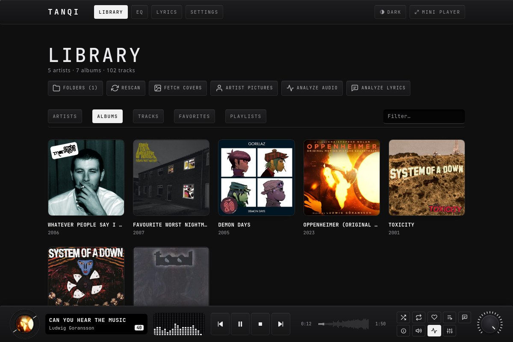
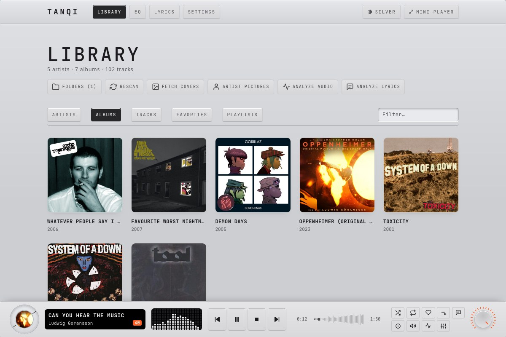
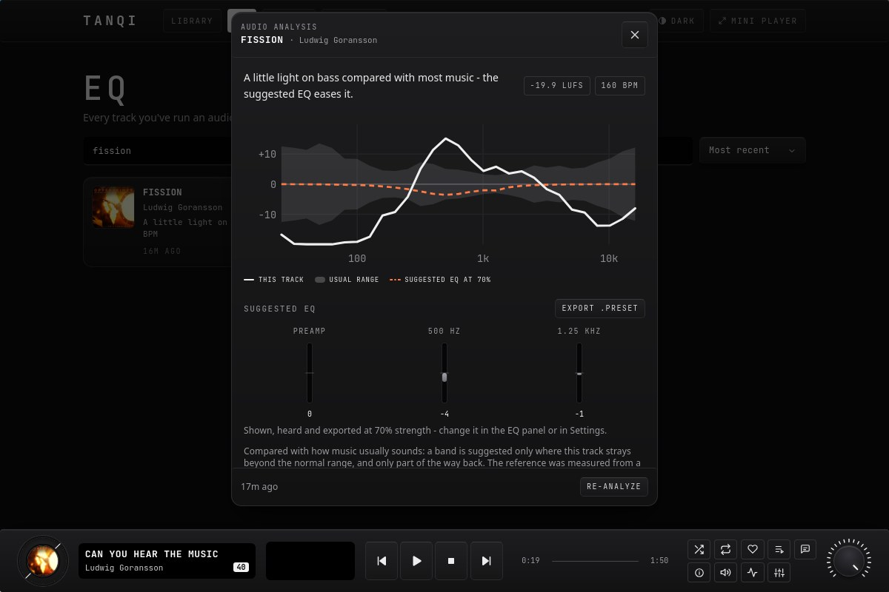
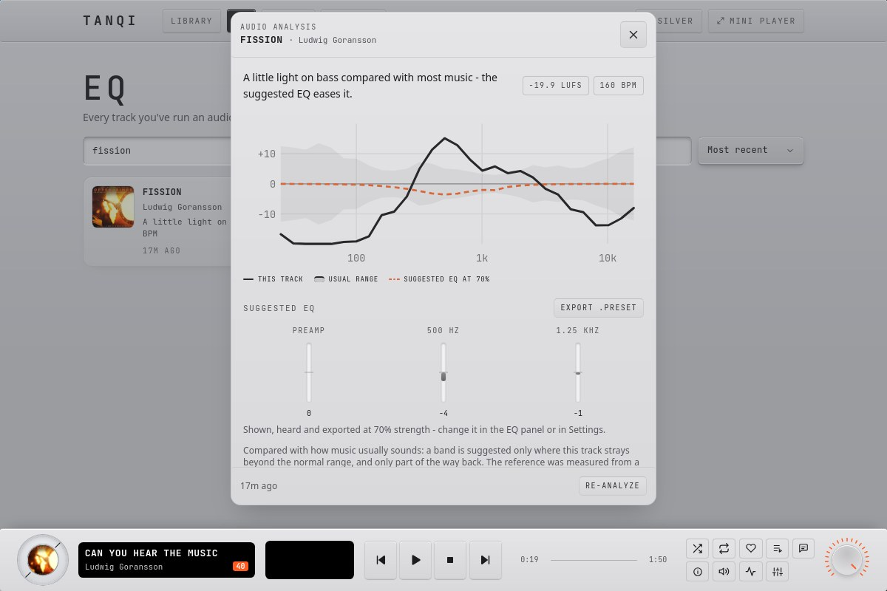
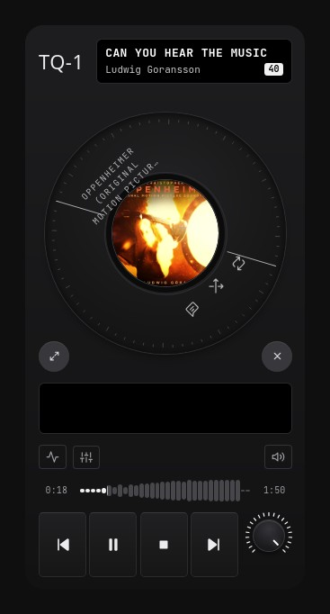
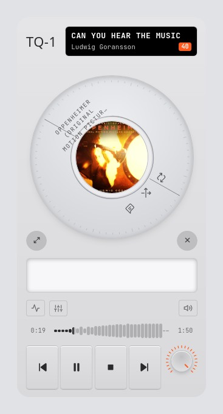
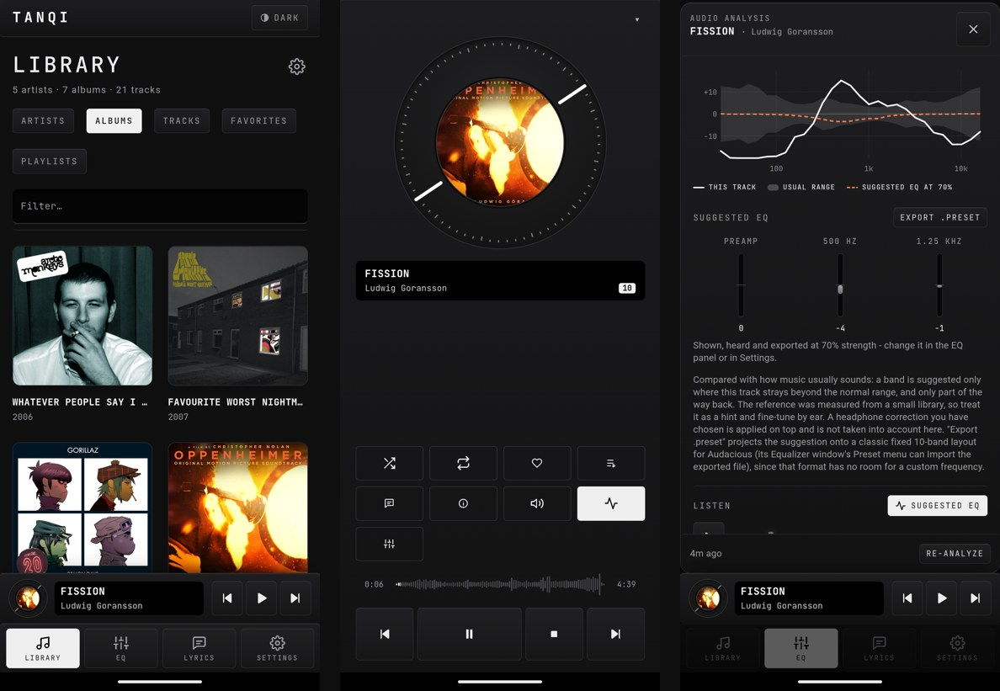
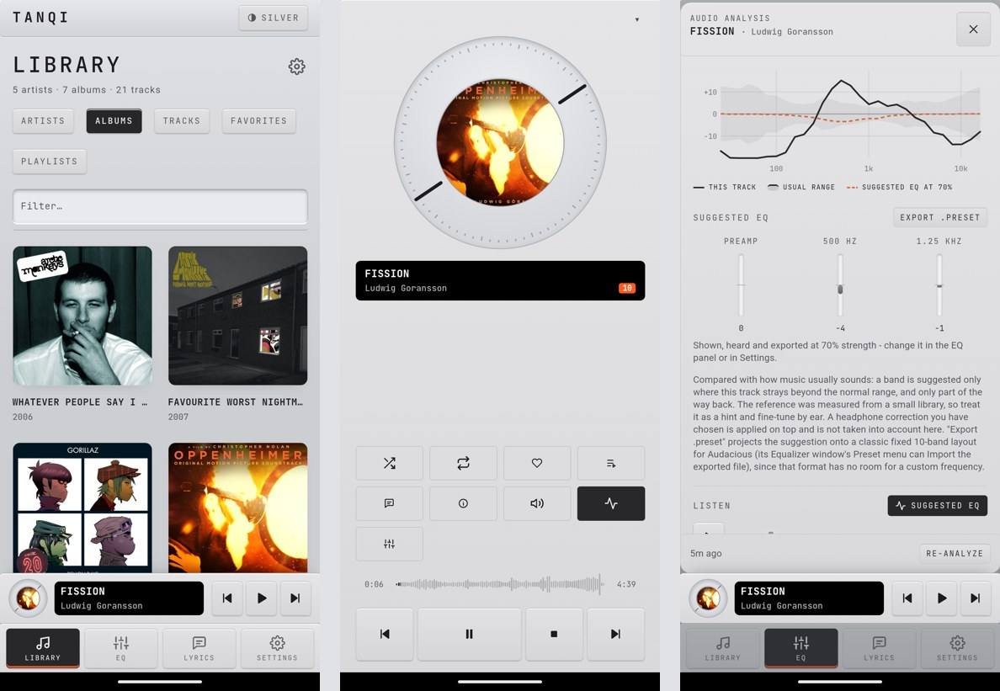

<p align="center">
  
</p>
<h1 align="center">Tanqi</h1>
<p align="center"><strong>A local-first music player that listens to your music for you: it measures each track, suggests an EQ, and reads the lyrics.<br/>One Rust app for the Linux desktop and Android.</strong></p>
<p align="center"><em>探奇 (tanqi)</em>: to seek unusual scenery or places.</p>
<div align="center">
  
  
  
  
</div>

<p align="center">
  
</p>

## Screenshots

Two skins ship with it: a dark one and a light **silver** one, switched from the button at the top right.

### Desktop

| Dark | Silver |
|---|---|
|  |  |
|  |  |

The always-on-top **mini player** is a small window of its own:

<p align="center">
  
  &nbsp;&nbsp;
  
</p>

### Phone

Library, Now Playing, and a track's EQ analysis, in each skin:

<p align="center">
  
</p>
<p align="center">
  
</p>

## Features

- 🎧 **A player first**: plain and local out of the box. **Audio analysis and suggested EQ** and **AI lyrics analysis** are optional; you pick them during onboarding and can switch them in Settings. With analysis off, the EQ button is your saved **headphone correction**: name each earphone once, then switch between them.
- 🎵 **Your files, your folders**: scans FLAC, MP3, M4A/AAC and WAV, groups the tags into artists, albums and tracks, and reads covers from the files.
- 🎚️ **Measures every track**: bass, mid and treble, loudness (LUFS, true peak), tempo (BPM) and key. A chart compares the track with how music usually sounds, and the **suggested EQ** eases only what strays beyond that, scaled by a strength setting (70% by default) you can fine-tune. Playback is levelled by loudness.

  > **Treat these numbers as a hint, not a measurement.** BPM, key, loudness and above all the suggested EQ are estimates and can be wrong. They were tuned and checked **by ear, on in-ear monitors (IEMs), by one person**, with no calibrated microphone or reference, and the "usual range" comes from a small library. Your mileage may vary: on other gear or to other ears the suggestion can sound worse than no EQ, so fine-tune it, lower the strength, or switch it off.
- 📝 **Lyrics that follow along**: synced lyrics from LRCLIB scroll with the song. The optional AI adds a vibe summary, notes on the lines worth explaining, topics, and an English translation.
- 🔒 **Local and private**: no account, no tracking. The AI is your own [Ollama](https://ollama.com) by default, or a hosted provider with your own API key ([Privacy](#privacy)).
- 📱🖥️ **Phone and desktop**: a tab bar, Now Playing and lock-screen controls on Android; media keys, MPRIS and an always-on-top mini player on Linux.
- 🎛️ **A device, not a web page**: a dark skin and a light "silver" skin, mono type, raised keys, a volume knob.

## What's in it

| Tab | Shows |
|---|---|
| **Library** | Artists, albums, tracks, favorites and playlists, plus tools for folders, rescanning, covers and analysing the whole library (behind the gear on a phone) |
| **EQ** *(optional)* | Every analysed track with its suggested EQ, tempo and key. Open one to listen with the EQ applied |
| **Lyrics** *(optional)* | Every track the AI has read, filterable by topic and by named person, place or thing |
| **Settings** | Notifications, the optional features, EQ strength, the AI provider, the two prompts the AI is given, and a *Danger zone* to delete stored data by kind |

Tap a track to play it. On a phone the **⋯** on a row opens its actions; on the desktop they appear when you hover.

## Install

Builds aren't published yet, so build it yourself. Rust 1.85+ is needed and, on Debian or Ubuntu, `libwebkit2gtk-4.1-dev libgtk-3-dev libxdo-dev libssl-dev libdbus-1-dev`.

```bash
# Run on Linux
cargo run --release

# A .deb and an AppImage (needs the Dioxus CLI, below)
dx bundle --release --platform desktop --package-types deb --package-types appimage

# A reproducible release binary, built in Docker
docker build --target artifact --output type=local,dest=dist .
```

### Android

```bash
# One time: Android SDK + NDK, JDK 17, the Rust targets and the Dioxus CLI
rustup target add aarch64-linux-android x86_64-linux-android
cargo install dioxus-cli --version 0.7.10 --locked

export ANDROID_HOME=~/Android/Sdk
export ANDROID_NDK_HOME=$ANDROID_HOME/ndk/26.3.11579264
export JAVA_HOME=~/Android/jdk17

# Phone (64-bit ARM, Android 7+); pass x86_64-linux-android for the emulator
icons/android-build.sh   # runs dx build, then puts the app's own launcher icon in (dx would use its default)

adb install -r target/dx/tanqi-music/debug/android/app/app/build/outputs/apk/debug/app-debug.apk
```

On first launch it asks to read your music and show notifications. Then open the **gear** next to *Library*, choose **Folders**, and add your music folder. When you switch between the two targets, delete the old `jniLibs/<other arch>` folder under `target/dx/.../app/src/main/`, or the APK carries both.

## Lyrics and the AI

Lyrics come from [LRCLIB](https://lrclib.net) and always work. The optional AI reading (summary, notes, topics, translation) needs a model. Pick one in **Settings → AI provider**:

**Ollama (default)** runs on your machine or another one:

```bash
ollama pull qwen3:8b        # the default; any model that answers in strict JSON with ~8k tokens of context works
```

The address defaults to this machine. To use a computer on your network from a phone:

```bash
sudo systemctl edit ollama      # add:  [Service]  Environment="OLLAMA_HOST=0.0.0.0"
sudo systemctl restart ollama
# in Tanqi: Settings → AI provider → address 192.168.1.20 → Save → Test connection
```

Ollama has no password, so only do this on a network you trust.

**Claude or OpenAI-compatible** (OpenAI, Gemini, OpenRouter, Groq, LM Studio, or any service with the OpenAI chat-completions API): choose a service or type its address (usually ending in `/v1`), paste your API key and the model id, then *Test connection*. The key is kept in your system keychain, or a private file in the app's data folder where there isn't one. It is never stored in the settings database and is sent only to that address.

## Good to know

- **Tempo and key** are read from the middle 90 seconds of a track to keep the work small enough for a phone. The spectrum and loudness use the whole track.
- **"Usual" is measured, not ideal**: the reference comes from about 900 tracks of the author's own library (rock, soundtracks, K-pop, Malay pop), so the suggested EQ flags what is unusual, not what is wrong.
- **Very large files** (a 30-minute lossless mix, say) can run an Android phone out of memory.
- **Android builds** are debug builds for now (about 120 MB); a signed release build isn't set up.
- **Windows, macOS and iOS** have never been built or tried.
- If you refuse the music permission on Android, Tanqi says why the library is empty and links to the app's settings. It never deletes your library because access is missing.

## Where your data lives

| | |
|---|---|
| Linux | `~/.local/share/com.tanqi.music/` (a SQLite database and the extracted covers) |
| Android | the app's private storage, removed when you uninstall |

Your music files are never changed. *Settings → Danger zone* removes only the app's own data.

## Privacy

No server of ours, no tracking. What leaves your device:

| What | Goes to | Why |
|---|---|---|
| Title, artist, album, length | [LRCLIB](https://lrclib.net) | Finding the lyrics |
| Title, artist | iTunes Search, MusicBrainz | Artwork and release details in Track info |
| Artist names (only when you press *Artist pictures*) | YouTube Music | Artist photos |
| Title, artist and lyrics (only when you run the AI) | Your AI provider: your own Ollama by default, or Claude / an OpenAI-compatible service with your key | The AI reading. A hosted provider receives the lyrics and may use your credit or quota |

Each service sees your IP address, like any website. Answers are remembered on your device for a while, so repeat lookups don't go out again.

## Docs

| | |
|---|---|
| [Glossary](GLOSSARY.md) | The words the app and code use |
| [ADR 0001](docs/adr/0001-favorites-and-playlists-refer-to-tracks-by-id.md), [ADR 0002](docs/adr/0002-suggested-eq-is-derived-from-the-stored-spectrum.md) | Architecture decisions |

The code is a library (`src/lib.rs`: database, scanner, audio analysis, AI and lyrics clients) with a Dioxus UI on top (`src/ui/`, styles in `assets/css/`). `cargo test` runs the tests.

## Licence

[MIT](LICENSE). The bundled font, JetBrains Mono, is under the SIL Open Font License.

## Credits

Built with [Rust](https://www.rust-lang.org) and [Dioxus](https://dioxuslabs.com). Audio decoding by [Symphonia](https://github.com/pdeljanov/Symphonia), spectra by [RustFFT](https://github.com/ejmahler/RustFFT), tempo and key by [stratum-dsp](https://crates.io/crates/stratum-dsp), storage by SQLite through [rusqlite](https://github.com/rusqlite/rusqlite). Lyrics from LRCLIB, artwork and release details from the iTunes Search API and MusicBrainz, artist pictures from YouTube Music, and the AI reading by [Ollama](https://ollama.com) or the provider you choose.
